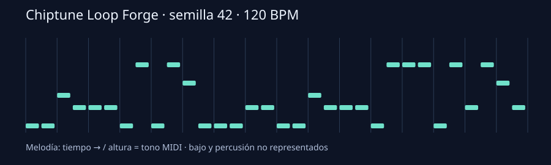

# Chiptune Loop Forge 🎵🎮

Genera pequeños loops de música retro para prototipos de videojuegos: melodía, bajo, bombo, caja y hi-hat, sintetizados en Python. Cambia la semilla para explorar melodías y guarda los parámetros para repetir un resultado.

Creado el **25 de octubre de 2026**. Requiere **Python 3.10+**, sin dependencias externas ni servicios.

## Crear y escuchar tu primer loop

```bash
git clone https://github.com/alvaroalcalaa/chiptune-loop-forge.git
cd chiptune-loop-forge
python forge.py --seed 42 --bpm 120 --bars 4 --out loop.wav --score score.json --svg melody.svg
python -m unittest -v
```

Abre `loop.wav` con tu reproductor, editor de audio o motor de juego. El ejemplo dura **8 segundos**: 4 compases de 4 pulsos a 120 BPM. En algunos equipos usa `python3`.

La salida es WAV PCM **mono, 16 bits, 22 050 Hz**. Los eventos de la partitura se guardan en JSON y el SVG muestra la melodía como piano roll.



## Tres puntos de partida

```bash
python forge.py --seed 42 --bpm 120 --mode minor --out adventure.wav
python forge.py --seed 19 --bpm 100 --mode major --out menu.wav
python forge.py --seed 77 --bpm 160 --root 62 --out stage.wav
```

Los presets están también en `examples/presets.json` como listas de argumentos; el CLI no carga ese archivo automáticamente. Son etiquetas creativas para explorar, no una clasificación musical automática.

## Parámetros

| Opción | Valor y límites |
|---|---|
| `--seed` | Semilla entera, 0–4 294 967 295; por defecto 42 |
| `--bpm` | Tempo entero, 60–200; por defecto 120 |
| `--bars` | Compases de 4 pulsos, 1–8; por defecto 4 |
| `--root` | Raíz MIDI, 48–72; por defecto 60 (do central) |
| `--mode` | `minor` o `major`; por defecto `minor` |
| `--out` | Archivo WAV, por defecto `loop.wav` |
| `--score` | Archivo JSON opcional con eventos |
| `--svg` | Piano roll SVG opcional |

Las carpetas de salida deben existir. Las salidas deben tener rutas distintas. Los archivos de salida existentes se reemplazan. El programa termina con código 0 si genera los archivos y 2 ante errores de argumentos o escritura.

## Cómo suena y cómo se construye

- Melodía con onda de pulso y una escala pentatónica mayor o menor.
- Motivo generado a partir de la semilla, alternado con variaciones.
- Bajo triangular sobre una progresión de cuatro raíces.
- Bombo de seno con barrido de frecuencia, caja y hi-hat de ruido.
- Ataque y liberación por evento, más un microfundido de 5 ms en los extremos.
- Normalización de pico al 90% antes de cuantizar a PCM.

La primera y la última muestra son cero para evitar un salto de amplitud al repetir. La duración se redondea a muestras enteras: a algunos tempos el ajuste temporal es aproximado, con error máximo de media muestra.

La misma configuración reproduce el resultado en el mismo entorno de Python; no se promete identidad binaria entre versiones o plataformas. No utiliza samples descargados ni intenta imitar una canción concreta. Es composición y síntesis procedural, **no un modelo generativo de IA**.

## Verificación

`python -m unittest -v` comprueba repetibilidad, cambios de melodía con la semilla, duración según tempo, rango PCM, extremos del loop, cabecera WAV, eventos dentro del compás, escala, parámetros, SVG y ejecución real del CLI.

El JSON de eventos contiene la receta musical; no es un archivo MIDI ni se puede reimportar con este CLI. Se incluye un SVG generado con el preset predeterminado para inspeccionar la melodía.

## Límites

El estilo es deliberadamente sencillo. Las ondas no están limitadas en banda y pueden producir aliasing; los microfundidos no garantizan una transición musical perfecta ni ausencia total de clics. No hay mezcla estéreo, efectos, mastering, reproducción en tiempo real, edición de instrumentos ni exportación MIDI.

Todo el audio se calcula en memoria, hasta 32 segundos con los límites actuales. Las pruebas validan propiedades del archivo y del algoritmo, no la calidad musical ni compatibilidad con todos los motores. Revisa el loop escuchándolo antes de incorporarlo a un proyecto.
